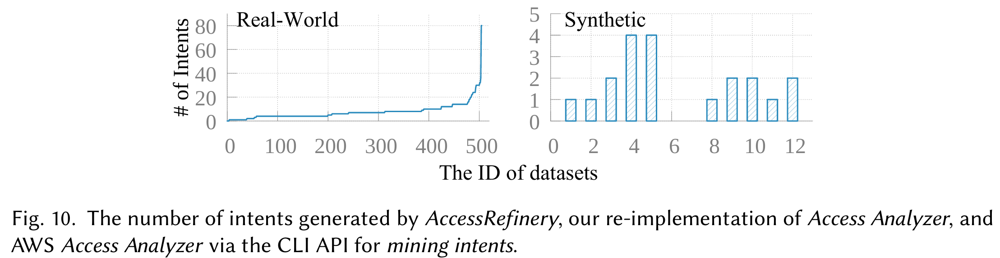
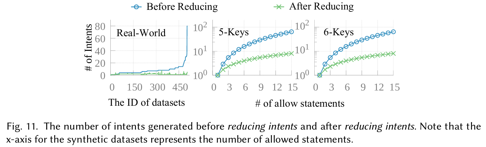
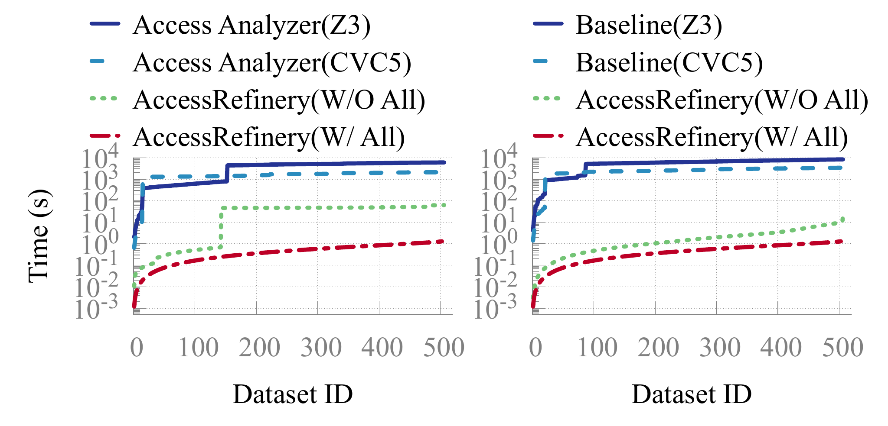
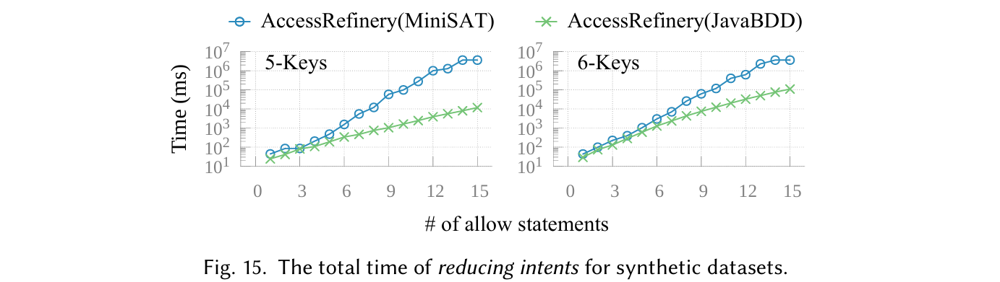
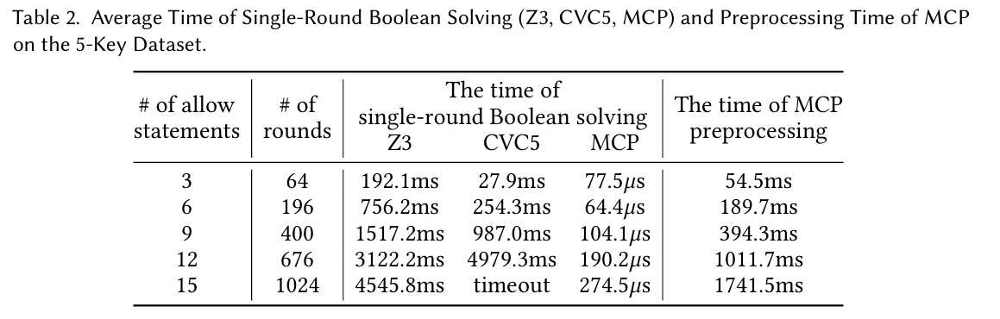
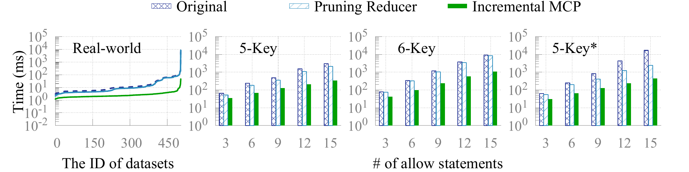
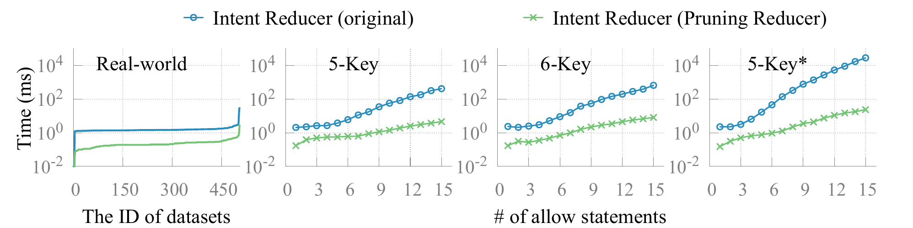
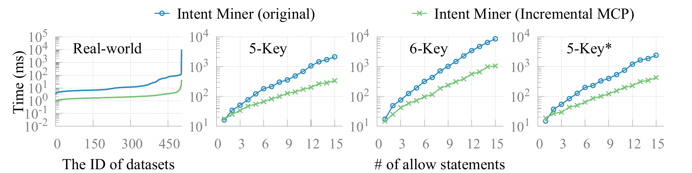
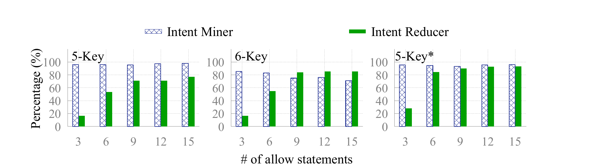

### Verifying Claims in the Paper

After generating `results/`, we explain how to reproduce the figures, tables, and conclusions reported in the paper.

This document covers two sets of experiments, and their material is kept apart so that either can be checked on its own:

- **§1-§13 — the experiments reported in the original submission.** Archived outputs in `archive_results/`, plotting inputs in `paper_figures/archive_data/`, `.plt` files in `paper_figures/gnuplot/`, rendered PDFs in `paper_figures/results/`.
- **§14-§18 — the extension experiment: the Original → Pruning Reducer → Incremental MCP optimization pipeline.** Archived outputs in `archive_results_new/`, plotting inputs in `paper_figures/archive_data_new/`, `.plt` files in `paper_figures/gnuplot_new/`, rendered PDFs in `paper_figures/results_new/`.

`results/` is shared: it is the working directory that the experiment scripts write to and that the extraction scripts read from.

Sections 1 and 2 reproduce the two claims the paper makes in its setup section (§6), before it states its research questions — the AWS CLI time-out and the identical intents of the two *Access Analyzer* versions — and therefore carry a section reference rather than a research question. From §3 on, each section is labelled with the research question it answers: RQ1-RQ6 for the original submission, RQ7-RQ9 for the extension experiment.

One overlap to be aware of: §8 and §9 (Figures 14 and 15) belong to the first set — their baselines and their `W/O All` series are the original ones — but they also plot the `AccessRefinery(W/ All)` series, which comes from the `Incremental MCP` stage of the pipeline. That series is the single-column `Experiment-*-WAll.dat` file, kept in `paper_figures/archive_data/` with the rest of those figures' inputs; §8 and §9 therefore read only `archive_data/`.

> **Note:** the real-world `RW` corpus is not public, for commercial reasons. The 506 raw policies of `data/RW/` are not released, so the runs that read them cannot be re-executed from this artifact.

#### 1. Claim Being Reproduced (Section 6):

"*AWS provides an online Command Line Interface (CLI) for Access Analyzer, which we use to validate the correctness of our re-implementation. Specifically, for the 6-key dataset with 11 to 15 statements, both versions time out (> 1 hour). ...*"

**Steps:**

See `archive_results/accessanalyzer_cli/Scalability_06Keys/run.log`. The run produced results for 1 to 10 statements and none beyond: the archived folder holds `01_allow_result.json` through `09_allow_result.json` — the tenth, written into the CLI's own `aws_result/` directory during the run, was not archived with the rest — and the last entry in the log is `11_allow.json`, which stops at `[2/5] Resource scan started` and never saves an intent. The 10-statement case also shows the scan breaking down rather than completing: it is given far more time than any earlier policy yet returns a single intent, where the intent count follows n² for every policy up to 9 (81 intents at 9 statements). This indicates that invoking *AWS Access Analyzer* via the CLI will exceed the one-hour limit on a 6-key dataset with 11 to 15 statements, with the 10-statement case already returning a truncated result.

```test
[4/5] intents saved at ./aws_result/Scalability_06Keys//10_allow_result.json
[5/5] 2025-05-11 18:06:51: Total running time  : 3386 seconds
[5/5] 2025-05-11 18:06:51: Final intents count : 1
```

See `archive_results/accessanalyzer_z3_miner_1rs/Scalability_06Keys/summary.csv`. Its rows stop at 10 statements:

```text
9,81,676,2.3068,1569.1607
10,100,881,2.9338,2596.6094
```

Each policy is run under a per-file limit of one hour (`TIMEOUT=3600` in `tools/accessanalyzer-reimpl/mining_miner_z3.sh`), and that script stops submitting further policies as soon as one of them hits the limit; a row is written only for a policy that produced a result file. The 10-statement case is already at 2596 seconds, and no rows exist for 11 to 15 — so the reimplemented Access Analyzer exceeded the one-hour limit on 11 to 15 statements. For contrast, `Scalability_05Keys/summary.csv` in the same folder is complete through all 15 statements.

```text
9,81,676,2.3068,1569.1607
10,100,881,2.9338,2596.6094
```

To this end, the conclusion holds.

#### 2. Claim Being Reproduced (Section 6):

"*AWS provides an online Command Line Interface (CLI) for Access Analyzer, which we use to validate the correctness of our re-implementation. ... Both versions produce identical intents on the Correctness, 5-key, and 6-key datasets.*"

**Running:**

The following command compares intents between the *reimplemented Access Analyzer* and the *CLI-based Access Analyzer*.

```shell
sh tools/accessanalyzer-reimpl/running_accessanalyzer_compare.sh
```

**Expected Output:**

- `results/accessanalyzer_miner_compare_results/*.log`

#### 3. Claim Being Reproduced (RQ1): 

"*We conducted a series of basic Boolean operation tests.*"

**Running:**

Running maven test for [MCPTest.java](https://github.com/XJTU-NetVerify/accessrefinery/blob/main/accessrefinery/mcp/src/test/java/org/iam/core/MCPTest.java).

```shell
# The execution takes about 3 minutes.
mvn clean install
mvn test -pl ./accessrefinery/mcp -Dtest=MCPTest#testComplexSATOperations
```

**Expected Output:**

```text
[INFO] ------------------------------------------------------------------------
[INFO] BUILD SUCCESS
[INFO] ------------------------------------------------------------------------
[INFO] Total time:  1.212 s
[INFO] Finished at: 2026-04-10T17:10:38+08:00
[INFO] ------------------------------------------------------------------------
```

#### 4. Target Figure (RQ1): Figure 12



**Running:**

We provide a script to clear previously rendered PDFs, so that every figure below is regenerated rather than reused.

```bash
sh tools/clean_plotting.sh
```

**Expected Output:**

```bash
Clearing paper_figures/results
Clearing paper_figures/results_new
```

The plotting inputs themselves live in `paper_figures/archive_data/` (the figures of the original submission) and `paper_figures/archive_data_new/` (the figures of the extension experiment, §14-§17, together with the plotting inputs those sections do not plot: `p_bar_ix_*.dat`, `rw_bar_ix.dat` and `10rs/seg_*.dat` from two withdrawn renderings, and `10rs/rw_enc.dat`); `clean_plotting.sh` never touches either, and the `.plt` files read them directly.

**Running:**

Use the `NumberMCI` values in `accessrefinery_bdd_miner_10rs/Correctness/summary.txt` to generate data of Figure 12 in the paper.

```bash
bash ./tools/figures/extract_correctness_synthetic.sh
```

**Expected Output:**

- `paper_figures/archive_data/Experiment-Correctness-Synthetic.dat`

**Running:**
(Preserve the parentheses when executing the command.)

```shell
(cd paper_figures && gnuplot gnuplot/RQ1-Experiment-Correctness.plt)
```

**Expected Output:**

- `paper_figures/results/RQ1-Experiment-Correctness.pdf`

#### 5. Claim Being Reproduced (RQ1):

"*We compared the intents produced by AccessRefinery (without intent reduction), our re-implementation of Access Analyzer, and the AWS Access Analyzer via the CLI API. On synthetic datasets, all three produce the same set of intents.*"

**Running:**

```bash
# Compare AccessRefinery and CLI-based Access Analyzer
sh tools/running_batch_compare.sh

# Compare AccessRefinery and reimplemented Access Analyzer
sh tools/accessanalyzer-reimpl/running_accessanalyzer_compare_with_refinery.sh
```

**Expected Output:**

- `results/`
  - `accessrefinery_miner_compare_results/*.log`
  - `accessanalyzer_miner_compare_results_with_refinery/*.log`

#### 6. Claim Being Reproduced (RQ1):

"*(1) The reduced intents fully cover the policy. (2) Removing any intent from the reduced intents causes the remaining intents to no longer cover the policy.*"

**Running:**

```bash
bash ./tools/accessanalyzer-reimpl/check_coverage.sh
```

**Expected Output:**

- `results/coverage_check/`
  - `Correctness/*_coverage.log`
  - `Scalability_05Keys/*_coverage.log`
  - `Scalability_06Keys/*_coverage.log`

#### 7. Target Figure (RQ2): Figure 13



**Running:**

The following command generates data of Figure 13 in the paper from

- `accessrefinery_bdd_reducer_10rs/`
  - `Scalability_05Keys/summary.txt`
  - `Scalability_06Keys/summary.txt`

The `NumberMCI` column represents the number of intents before reduction, and the `NumberRRI` column represents the number after reduction.

```bash
bash tools/figures/extract_effectiveness_synthetic.sh
```

**Expected Output:**

- `paper_figures/archive_data/`
  - `Experiment-Effectiveness-Synthetic-K2.dat`
  - `Experiment-Effectiveness-Synthetic-K3.dat`

**Running:**

```shell
# plot the figure
(cd paper_figures && gnuplot gnuplot/RQ2-Experiment-Effectiveness.plt)
ls paper_figures/results/RQ2*
```

**Expected Output:**

```text
paper_figures/results/RQ2-Experiment-Effectiveness.pdf
```

#### 8. Target Figure (RQ3): Figure 14


**Running:**

The following command generates data of Figure 14 in the paper from

- `accessrefinery_bdd_miner_10rs/` : `AccessRefinery(W/O All)` in the figure.
  - `Scalability_05Keys/summary.txt` : see `TotalTimeAverage` column
  - `Scalability_06Keys/summary.txt` : see `TotalTimeAverage` column
- `accessrefinery_bdd_reducer_IncrementalMCP_20rs/` : `AccessRefinery(W/ All)` in the figure, the same mining work with all three optimizations on.
  - `Scalability_05Keys/summary.txt` : see `MCILabelsTimeAverage + MCIOperationsTimeAverage` columns (the rest of that summary is reduction, which the figure does not plot)
  - `Scalability_06Keys/summary.txt` : see `MCILabelsTimeAverage + MCIOperationsTimeAverage` columns
- `accessanalyzer_z3_miner_1rs/` : `Access Analyzer(Z3)` in the figure.
  - `Scalability_05Keys/summary.csv` : see `Total Time (s)` column
  - `Scalability_06Keys/summary.csv` : see `Total Time (s)` column
- `accessanalyzer_cvc5_miner_1rs/` : `Access Analyzer(CVC5)` in the figure.
  - `Scalability_05Keys/summary.csv` : see `Total Time (s)` column
  - `Scalability_06Keys/summary.csv` : see `Total Time (s)` column

The `AccessRefinery` columns are milliseconds and the `Access Analyzer` columns are seconds; `extract_scalability_MCI.sh` multiplies the latter by 1000 so that every column of the generated `.dat` is in milliseconds, and clamps anything above `3600000` (one hour) to that value, so a timed-out run is plotted at the limit.

The `AccessRefinery(W/ All)` series comes from the `Incremental MCP` stage of the pipeline, whose runs reduce as well as mine. Reduction is the last two columns of that summary (`RRIOperationsTimeAverage` and `RRIILPSolvingTimeAverage`), and `c5 = c6 + c7 + c8 + c9`, so the sum of the two before them (`MCILabelsTimeAverage + MCIOperationsTimeAverage`) is the mining cost this figure compares. `extract_scalability_MCI.sh` writes that reduction to its own single-column `-WAll.dat` file rather than appending a column to the `.dat` above, so the existing columns stay as they are.

```bash
bash tools/figures/extract_scalability_MCI.sh
```

**Expected Output:**

- `paper_figures/archive_data/`
  - `Experiment-Scalability-MCI-K2.dat`
  - `Experiment-Scalability-MCI-K3.dat`
  - `Experiment-Scalability-MCI-K2-WAll.dat`
  - `Experiment-Scalability-MCI-K3-WAll.dat`

**Running:**

```shell
(cd paper_figures && gnuplot gnuplot/RQ3-Experiment-Scalability-Mining.plt)
```

**Expected Output:**

- `paper_figures/results/RQ3-Experiment-Scalability-Mining.pdf`

#### 9. Target Figure (RQ3): Figure 15


**Running:**

The following command generates data of Figure 15 in the paper from

- `accessrefinery_bdd_reducer_10rs/` : `AccessRefinery(W/O All)` in the figure.
  - `Scalability_05Keys/summary.txt` : see `TotalTimeAverage` column
  - `Scalability_06Keys/summary.txt` : see `TotalTimeAverage` column
- `accessrefinery_bdd_reducer_IncrementalMCP_20rs/` : `AccessRefinery(W/ All)` in the figure, the same reduction work with all three optimizations on.
  - `Scalability_05Keys/summary.txt` : see `TotalTimeAverage` column, which is the whole run (mine plus reduce), the same quantity as the column above
  - `Scalability_06Keys/summary.txt` : see `TotalTimeAverage` column
- `accessanalyzer_z3_reducer_1rs/` : `Access Analyzer(Z3)` in the figure. 
  - `Scalability_05Keys/summary.csv` : see `Total Time (s)` column
  - `Scalability_06Keys/summary.csv` : see `Total Time (s)` column
- `accessanalyzer_cvc5_reducer_1rs/` : `Access Analyzer(CVC5)` in the figure. 
  - `Scalability_05Keys/summary.csv` : see `Total Time (s)` column
  - `Scalability_06Keys/summary.csv` : see `Total Time (s)` column

```bash
bash tools/figures/extract_scalability_RRI.sh
```

**Expected Output:**

- `paper_figures/archive_data/`
  - `Experiment-Scalability-RRI-K2.dat`
  - `Experiment-Scalability-RRI-K3.dat`
  - `Experiment-Scalability-RRI-K2-WAll.dat`
  - `Experiment-Scalability-RRI-K3-WAll.dat`

**Running:**

```shell
(cd paper_figures && gnuplot gnuplot/RQ3-Experiment-Scalability-Reducing.plt)
```

**Expected Output:**

- `paper_figures/results/RQ3-Experiment-Scalability-Reducing.pdf`

#### 10. Target Figure (RQ4): Figure 16



The real-world `RW` data this figure reports on is not public, for commercial reasons, so this reproduction is not available.

#### 11. Claim Being Reproduced (RQ5):

"*For intent mining, using JavaBDD is 1-6x faster than using MiniSAT (for clarity, the figure is omitted).*"

**Running:**

The following command generates the data of the mining micro-benchmark from

- `accessrefinery_bdd_miner_10rs/` : time for `JavaBDD` in the paper
  - `Scalability_05Keys/summary.txt` : see `TotalTimeAverage` column
  - `Scalability_06Keys/summary.txt` : see `TotalTimeAverage` column
- `accessrefinery_sat_miner_10rs/` : time for `MiniSAT` in the paper
  - `Scalability_05Keys/summary.txt` : see `TotalTimeAverage` column
  - `Scalability_06Keys/summary.txt` : see `TotalTimeAverage` column

This extraction is shared with Figure 14: `extract_scalability_MCI.sh` writes the `Z3`, `CVC5`, `MiniSAT` and `JavaBDD` columns into the same `Experiment-Scalability-MCI-K2/K3.dat` files, so if Figure 14 has already been reproduced there is nothing left to run here.

```bash
bash tools/figures/extract_scalability_MCI.sh
```

**Expected Output:**

- `paper_figures/archive_data/`
  - `Experiment-Scalability-MCI-K2.dat`
  - `Experiment-Scalability-MCI-K3.dat`
  - `Experiment-Scalability-MCI-K2-WAll.dat`
  - `Experiment-Scalability-MCI-K3-WAll.dat`

**Running:**

The following command generates the figure omitted in the paper.

```shell
(cd paper_figures && gnuplot gnuplot/RQ5-Experiment-MicroBenchmark-Mining.plt)
```

**Expected Output:**

- `paper_figures/results/RQ5-Experiment-MicroBenchmark-Mining.pdf`

#### 12. Target Figure (RQ5): Figure 17



**Running:**

The following command generates data of Figure 17 in the paper from

- `accessrefinery_bdd_reducer_10rs/` time for `JavaBDD` in the paper
  - `Scalability_05Keys/summary.txt` see `TotalTimeAverage` column
  - `Scalability_06Keys/summary.txt` see `TotalTimeAverage` column
- `accessrefinery_sat_reducer_3rs/` time for `MiniSAT` in the paper
  - `Scalability_05Keys/summary.txt` see `TotalTimeAverage` column
  - `Scalability_06Keys/summary.txt` see `TotalTimeAverage` column

> Note: Since SAT-based reduction is much slower, we report SAT results for only 3 rounds. Every `summary.txt` reports `TotalTimeAverage` as the average over the rounds that run actually completed, so comparing that column already compares average time per round — the 3-round SAT run and the 10-round BDD run need no further normalization.

This extraction is shared with Figure 15: `extract_scalability_RRI.sh` writes the `Z3`, `CVC5`, `MiniSAT` and `JavaBDD` columns into the same `Experiment-Scalability-RRI-K2/K3.dat` files, so if Figure 15 has already been reproduced there is nothing left to run here.

```bash
bash tools/figures/extract_scalability_RRI.sh
```

**Expected Output:**

- `paper_figures/archive_data/`
  - `Experiment-Scalability-RRI-K2.dat`
  - `Experiment-Scalability-RRI-K3.dat`
  - `Experiment-Scalability-RRI-K2-WAll.dat`
  - `Experiment-Scalability-RRI-K3-WAll.dat`

**Running:**

The following command generates Figure 17 in the paper.

```shell
(cd paper_figures && gnuplot gnuplot/RQ5-Experiment-MicroBenchmark-Reducing.plt)
```

**Expected Output:**

- `paper_figures/results/RQ5-Experiment-MicroBenchmark-Reducing.pdf`

#### 13. Target Table (RQ6): Table 2



**Required logs**:

- `accessrefinery_bdd_miner_10rs/`
  - `Scalability_05Keys/summary.txt`

The `MCISolvingRoundAverage` column in `summary.txt` file is the number of SMT solving rounds in the table. The `MCILabelsTimeAverage` column is the average MCP preprocessing time in the table. `MCIOperationsTimeAverage / MCISolvingRoundAverage` is the single-round Boolean solving time in the table. The `NumberMCI` column is the number of mined intents, reported as the `# intents` column of the generated table; `NumberRRI` (the number of reduced intents) is not used by `tools/figures/generate_table.sh`.

- `accessanalyzer_z3_miner_1rs/`
  - `Scalability_05Keys/summary.csv`
- `accessanalyzer_cvc5_miner_1rs/`
  - `Scalability_05Keys/summary.csv`

The `Average Time per Round (s)` column in `summary.csv` file is the average single-round SMT solving time in the table for `Z3` and `CVC5`.

The table is generated by LaTeX. Therefore, no plotting program is used.

#### 14. Target Figure (RQ7): Figure 18

> ## Extension Experiment: §14-§18
>
> Sections 14 to 18 reproduce the extension experiment of this revision: the **Original → Pruning Reducer → Incremental MCP optimization pipeline**, whose three stages isolate one optimization each. They are the only sections that need `archive_results_new/`, `paper_figures/gnuplot_new/`, `paper_figures/archive_data_new/` and `paper_figures/results_new/`. §1-§13 do not read any of them.
>
> The real-world `RW` corpus is not public, for commercial reasons, so this reproduction covers the `05Keys`, `06Keys` and `05Keys∗` datasets.
>
> Figures 18-20 each carry a fourth, real-world panel besides the three synthetic ones. Those panels are read from the plotting data that ships in `paper_figures/archive_data_new/` (`rw_p1.dat` at the top level, and `rw_bar3.dat` and `rw_p2.dat` under `10rs/`). The per-stage `RW/summary.txt` they were extracted from are not public, for commercial reasons, like the corpus itself, so those panels are not recomputed: the extraction scripts skip them and leave the archived `.dat` in place.



**Required logs**:

`results/accessrefinery_bdd_reducer_{Original,PruningReducer,IncrementalMCP}_10rs/` must hold the three stage folders of the 10-round re-run, each with its own `summary.txt` per dataset — the extraction script reads them there. If `results/` does not have them yet, populate it from the archive rather than re-running the pipeline:

```shell
mkdir -p results/
for stage in _Original _PruningReducer _IncrementalMCP; do
  cp -r archive_results_new/accessrefinery_bdd_reducer${stage}_10rs results/
done
```

- `results/accessrefinery_bdd_reducer_Original_10rs/` — **Original**, the pipeline with all three optimizations off.
- `results/accessrefinery_bdd_reducer_PruningReducer_10rs/` — **Pruning Reducer**, Original plus the reducer's essential-finding pre-filter.
- `results/accessrefinery_bdd_reducer_IncrementalMCP_10rs/` — **Incremental MCP**, Pruning Reducer plus the miner's residual-BDD reduction and the incremental EC engine (all defaults).

All three hold the same three configurations as `tools/accessrefinery/running_bdd_reducer_20rs.sh`, whose cumulative switches are described in [README](README.md#optimization-pipeline), but were run with `--round 10`; no script in this artifact re-runs them at 10 rounds, so populate `results/` from `archive_results_new/` as above. This figure compares the per-policy total execution time, `TotalTimeAverage` (column 5).

**Running:**

```bash
bash tools/figures/extract_optimization_pipeline_10rs.sh
```

This one script regenerates the plotting data of the three figures that read the 10-round re-run (Figures 18, 20 and 21) into `paper_figures/archive_data_new/10rs/`; §15 runs `tools/figures/extract_optimization_pipeline.sh` instead, which regenerates Figure 19 from the 20-round archive under `results/`.

**Expected Output:**

- `paper_figures/archive_data_new/10rs/bar3_05.dat`, `bar3_06.dat`, `bar3_07.dat`
  Header `idx Original PruningReducer IncrementalMCP`: column 5 of all three stages for the five policies of each Scalability dataset that have 3, 6, 9, 12 and 15 statements — i.e. summary rows 3, 6, 9, 12 and 15, the same rows tabulated by Table 2.
- `paper_figures/archive_data_new/10rs/rw_bar3.dat` — the `RW` panel, written only when the withheld real-world summaries are present.

**Running:**

```shell
(cd paper_figures && gnuplot gnuplot_new/RQ7-Optimization-Overview-Bars-3Stage.plt)
```

**Expected Output:**

- `paper_figures/results_new/RQ7-Optimization-Overview-Bars-3Stage.pdf`

The earlier rendering of this figure, `Optimization-Overview-Bars.pdf`, took its three stages from the 20-round archive instead (`paper_figures/archive_data_new/p_bar_ix_05/06/07.dat` and `rw_bar_ix.dat`, produced by `tools/figures/extract_optimization_pipeline.sh` from `results/accessrefinery_bdd_reducer_*_20rs/`). It is not shipped in this revision; those files stay checked in for the record.

#### 15. Target Figure (RQ8): Figure 19



**Required logs**:

`results/` must hold the three stage folders of the 20-round run, each with its own `summary.txt` per dataset — the extraction script reads them there. If `results/` does not have them yet, populate it from the archive rather than re-running the pipeline:

```shell
mkdir -p results/
for stage in _Original _PruningReducer _IncrementalMCP; do
  cp -r archive_results_new/accessrefinery_bdd_reducer${stage}_20rs results/
done
```

- `results/accessrefinery_bdd_reducer_Original_20rs/` — **Original**, the pipeline with all three optimizations off.
- `results/accessrefinery_bdd_reducer_PruningReducer_20rs/` — **Pruning Reducer**, Original plus the reducer's essential-finding pre-filter.
- `results/accessrefinery_bdd_reducer_IncrementalMCP_20rs/` — **Incremental MCP**, Pruning Reducer plus the miner's residual-BDD reduction and the incremental EC engine (all defaults).

**Running:**

This figure isolates the intent reducer: columns 8 and 9 (`RRIOperationsTimeAverage + RRIILPSolvingTimeAverage`, the set-cover cost over the candidates) of the Original stage against the same two columns of Pruning Reducer.

```bash
bash tools/figures/extract_optimization_pipeline.sh
```

**Expected Output:**

- `paper_figures/archive_data_new/p1_05.dat`, `p1_06.dat`, `p1_07.dat`
  Header `Policy A B`: the Original and Pruning Reducer stages for `Scalability_05Keys`, `06Keys` and `05Keys∗` respectively, in `summary.txt` row order, policies numbered 1 to 15.

**Running:**

```shell
(cd paper_figures && gnuplot gnuplot_new/RQ8-ReducingPruning-Original-PruningReducer.plt)
```

**Expected Output:**

- `paper_figures/results_new/RQ8-ReducingPruning-Original-PruningReducer.pdf`

#### 16. Target Figure (RQ8): Figure 20



**Running:**

This figure isolates the intent miner: the mining cost of the Pruning Reducer stage against the Incremental MCP stage, i.e. columns 6 and 7 (`MCILabelsTimeAverage + MCIOperationsTimeAverage`, the label update and the node computation, with the reducer's two columns taken out) of the two. Like §14 it reads the 10-round re-run, whose stage folders ship with this artifact, so the archive-copy loop of §15 does not apply.

```bash
bash tools/figures/extract_optimization_pipeline_10rs.sh
```

**Expected Output:**

- `paper_figures/archive_data_new/10rs/p2_05.dat`, `p2_06.dat`, `p2_07.dat`
  Header `Policy A B`: Pruning Reducer and Incremental MCP for `Scalability_05Keys`, `06Keys` and `05Keys∗`, in `summary.txt` row order, policies numbered 1 to 15.
- `paper_figures/archive_data_new/10rs/rw_p2.dat` — the `RW` panel, written only when the withheld real-world summaries are present.

**Running:**

```shell
(cd paper_figures && gnuplot gnuplot_new/RQ8-MiningPruning-PruningReducer-IncrementalMCP.plt)
```

**Expected Output:**

- `paper_figures/results_new/RQ8-MiningPruning-PruningReducer-IncrementalMCP.pdf`

#### 17. Target Figure (RQ9): Figure 21



**Running:**

This figure reports how much of each phase's window goes to the encoding side, on the `MiningOptimized` configuration — the mining phase's search optimization alone, `-Dopt.ar=false -Dopt.am=true -Dopt.ai=false`, which is not one of the three pipeline stages. Its two shares are read from that configuration's own `summary.txt`: the intent miner's share is `100*c6/(c6+c7)`, its window up to the end of the label tree, and the intent reducer's is `100*c8/(c8+c9)`, its window up to the end of the EC encoding of the findings. The configuration is optional: without `results/accessrefinery_bdd_reducer_MiningOptimized_10rs/`, the script skips this figure's data and everything else in §14-§17 still reproduces.

```bash
bash tools/figures/extract_optimization_pipeline_10rs.sh
```

**Expected Output:**

- `paper_figures/archive_data_new/10rs/enc_05.dat`, `enc_06.dat`, `enc_07.dat`
  Header `idx Miner Reducer`: the two shares, in percent, for the policies of 3, 6, 9, 12 and 15 statements, numbered 0 to 4.
- `paper_figures/archive_data_new/10rs/rw_enc.dat` — the same two shares over the withheld real-world policies, written only when `results/accessrefinery_bdd_reducer_MiningOptimized_10rs/RW/` is present; no figure of this artifact reads it, the paper's Figure 21 having no real-world panel.

**Running:**

```shell
(cd paper_figures && gnuplot gnuplot_new/RQ9-Optimization-Overview-Bars-Percentage.plt)
```

**Expected Output:**

- `paper_figures/results_new/RQ9-Optimization-Overview-Bars-Percentage.pdf`

#### 18. Claim Being Reproduced (RQ9):

"*On the RW dataset we compare full and incremental handling of one newly added label, given that the original data has already been processed.*"

The real-world `RW` data this claim reports on is not public, for commercial reasons, so this claim is not reproduced here.